# Laser Harp | Erasmus+ 2026

**A playable, eight-beam laser harp built during an international vocational training project in Slovakia.**  
`Raspberry Pi` · `ESP32` · `Python` · `FluidSynth` · `Sensors` · `3D Printing`

<p align="center">
  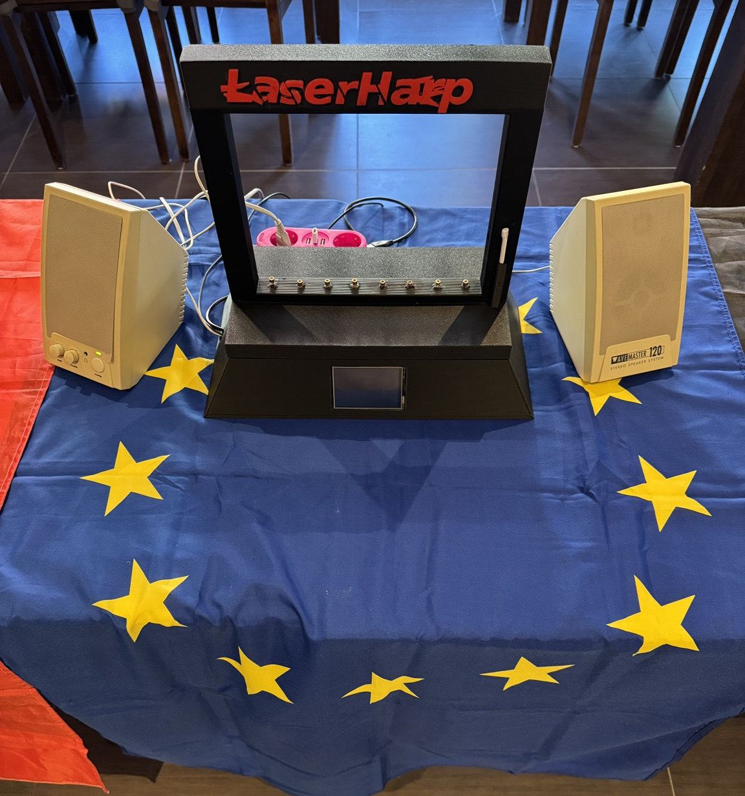
</p>

<p align="center"><em>The finished prototype, presented at the end of our Erasmus+ project in September 2026.</em></p>

## See it in action

[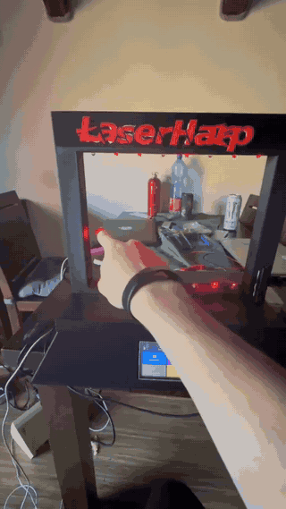](assets/video/final-laser-harp-demo.mp4)

**[▶ Watch the complete 25-second demonstration with sound (MP4)](assets/video/final-laser-harp-demo.mp4)**  
*The animation above is silent. Open the video to see the laser harp and touchscreen in use.*

---

## Project overview

What happens when a musical instrument replaces physical strings with beams of light?

During an **Erasmus+ vocational training mobility in Slovakia (September 2026)**, our team designed and assembled an interactive **laser harp**. The instrument uses **eight laser beams** and light sensors to recognize hand movements and trigger musical notes. A microcontroller captures the sensor signals, while a Raspberry Pi handles the software-based sound output and touchscreen interface.

The initial concept was planned in Germany. Over the course of the mobility, we tested components, solved hardware and software issues, fabricated the enclosure, integrated the subsystems, and demonstrated the functioning instrument during an English-language presentation.

| Project | Details |
|:--|:--|
| **Context** | Erasmus+ international vocational education project |
| **Location** | Slovakia |
| **Period** | September 2026 |
| **Outcome** | Working educational prototype with eight laser beams |
| **My role** | Contributed across hardware, software, testing, assembly, and documentation as part of a team |
| **Repository type** | Engineering case study and project documentation, **not** a downloadable software release |

## System architecture

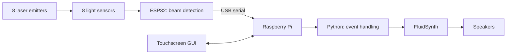

1. Each laser points toward a corresponding light sensor.
2. When a hand interrupts a beam, the ESP32 detects a change in the sensor signal.
3. The microcontroller sends the detected event to the Raspberry Pi via serial USB communication.
4. Python processes the event and uses FluidSynth to play the corresponding note.
5. A touchscreen GUI provides access to sound and instrument settings.

*This diagram summarizes the architecture described in the team's documentation. It is conceptual, not a complete circuit or pinout diagram.*

## Technologies

| Layer | Components and tools |
|:--|:--|
| **Embedded hardware** | ESP32 microcontroller, laser modules, phototransistors / light sensors |
| **Host system** | Raspberry Pi, Linux-based environment |
| **Programming** | Python, serial communication, device detection |
| **Sound** | FluidSynth, audio output through speakers |
| **Interface** | Touchscreen, custom GUI |
| **Fabrication** | 3D modelling, 3D printing, laser cutting, soldering |
| **Validation** | Serial monitor measurements, functional tests, iterative debugging |

## From prototype to finished instrument

### 01 · Test the electronics

We began by testing laser modules, LDRs and phototransistors with an ESP32. Serial-monitor readings helped us evaluate the sensor behaviour. Phototransistors were selected for reliable beam interruption detection, and we built a working single-beam prototype.

| Early beam-detection prototype | ESP32 on the breadboard |
|:--:|:--:|
| 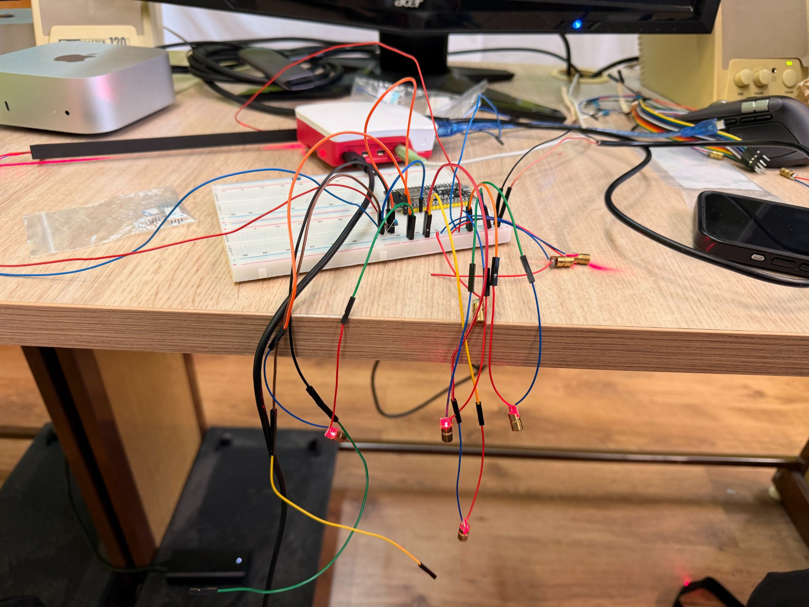 | 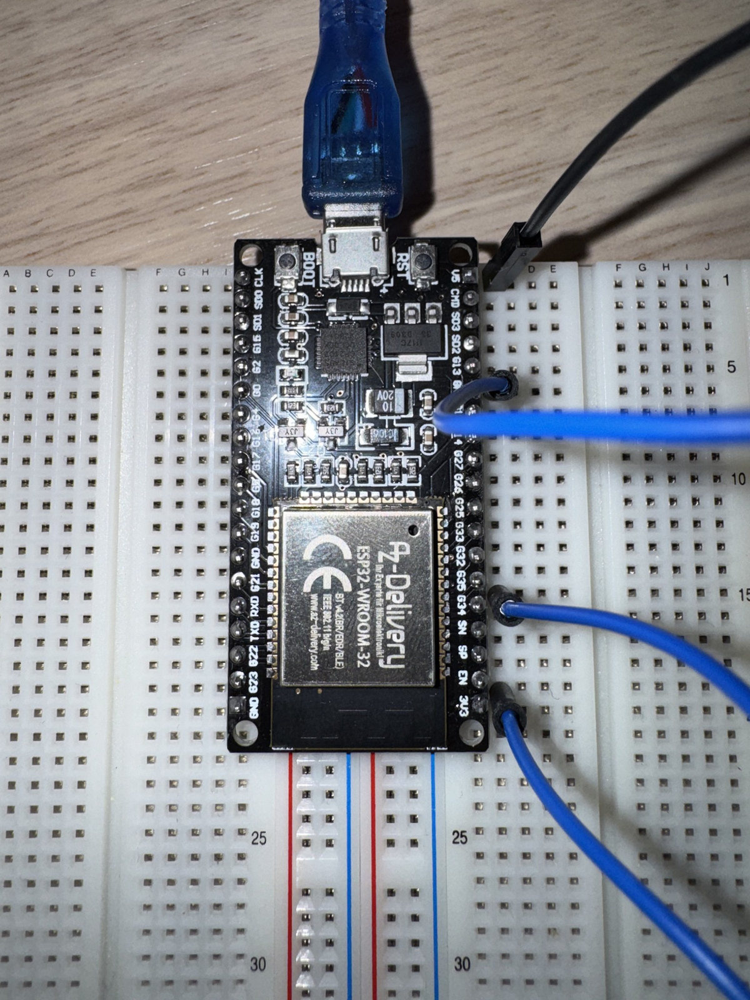 |

### 02 · Make the harp produce sound

We configured a Raspberry Pi, established communication with the ESP32, and connected a Python-based event handler to the FluidSynth sound engine. The first audible notes confirmed the end-to-end signal path. We also worked on a touchscreen GUI for instrument control.

| Python sound engine development | Raspberry Pi and touchscreen testing |
|:--:|:--:|
| 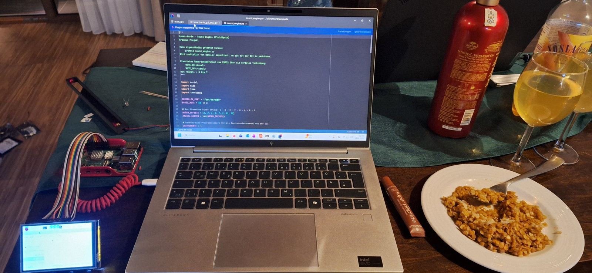 | 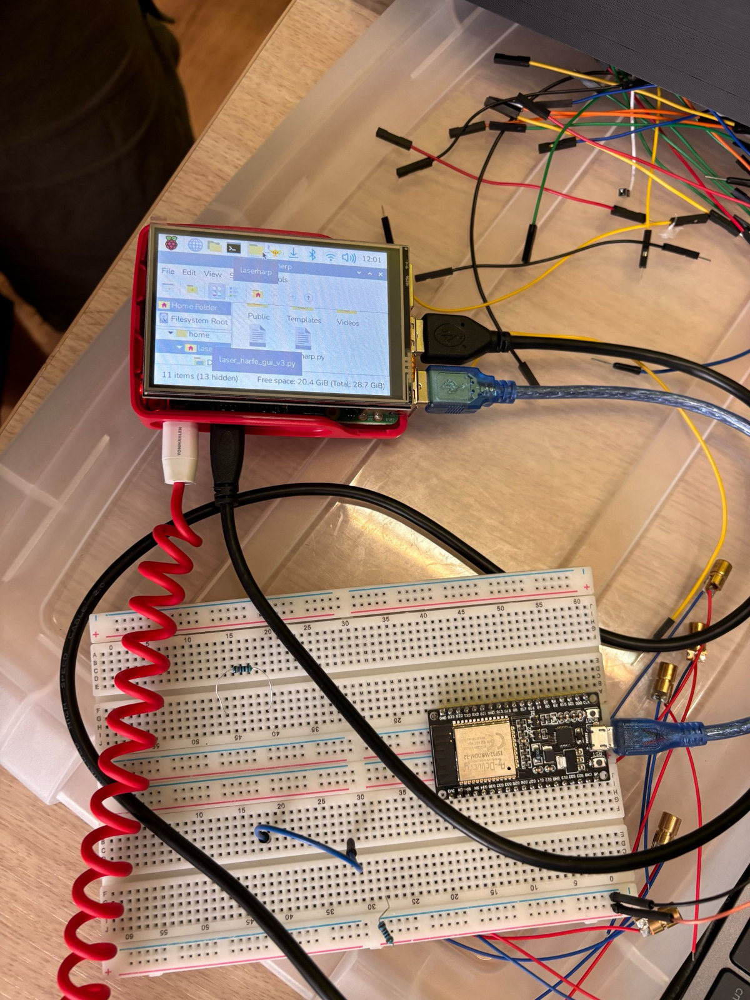 |

### 03 · Design and assemble the instrument

After the first functional tests, the focus shifted to mechanical stability and integration. We prepared custom 3D-printed parts, manufactured the enclosure, soldered and aligned the laser/sensor pairs, and installed the electronics.

| Digital enclosure model | Laser-cut acrylic panel |
|:--:|:--:|
| 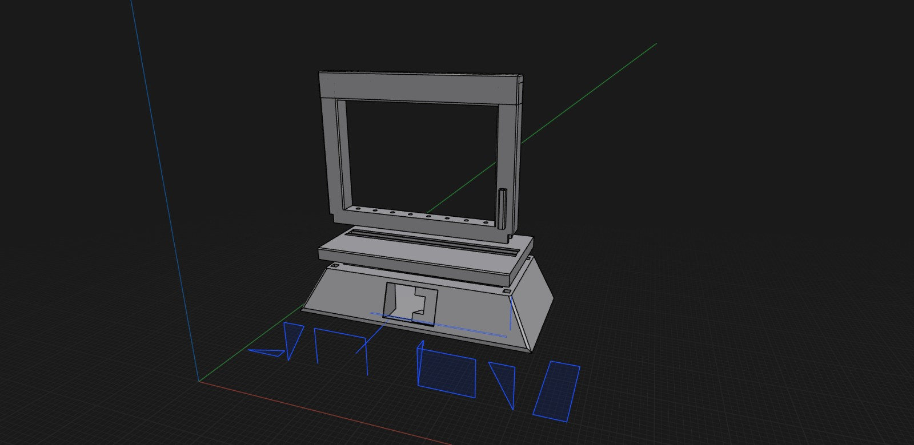 | 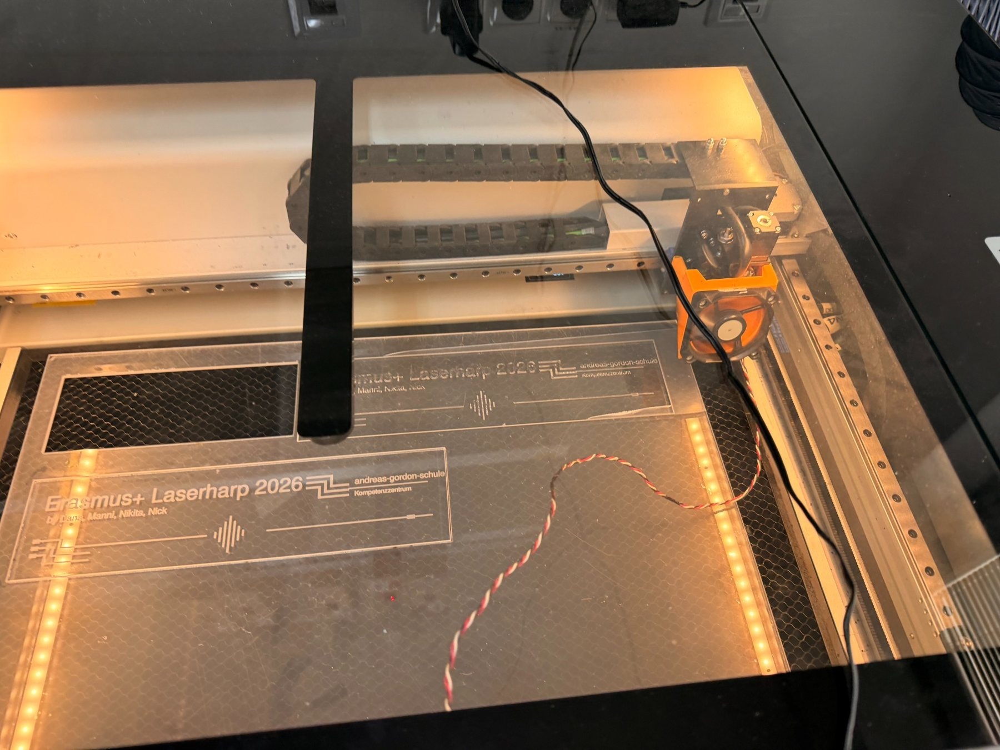 |

| Enclosure construction | Wiring and electronics integration |
|:--:|:--:|
| 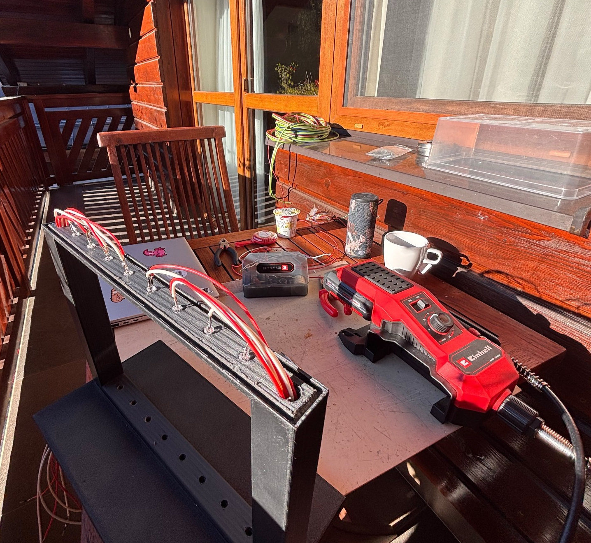 | 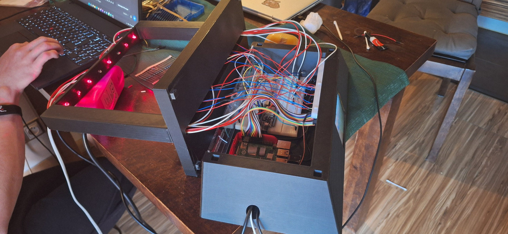 |

*Integrating mechanics, electronics and software into one instrument.*

### Behind the scenes · teamwork

| Building and soldering | Collaborative troubleshooting |
|:--:|:--:|
| 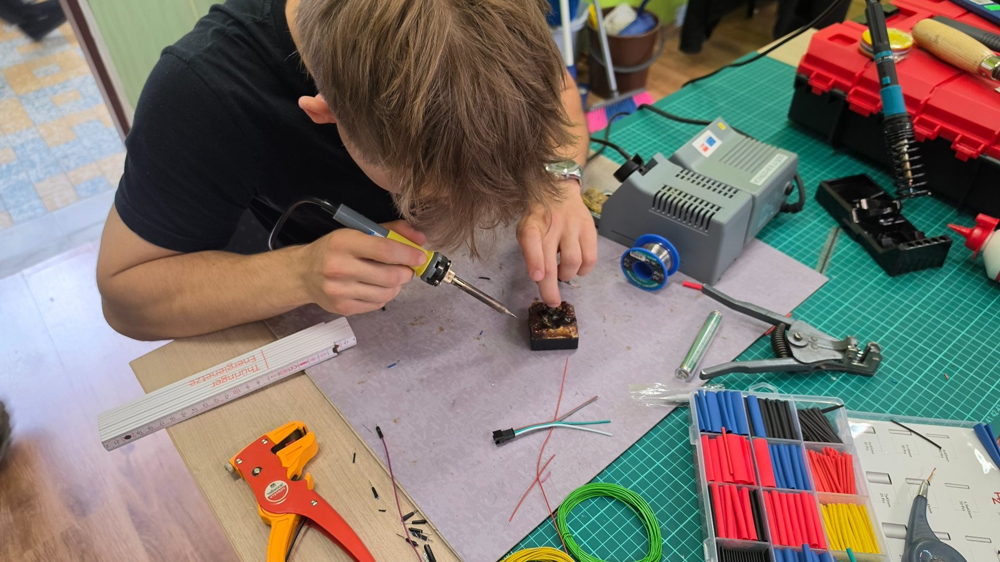 | 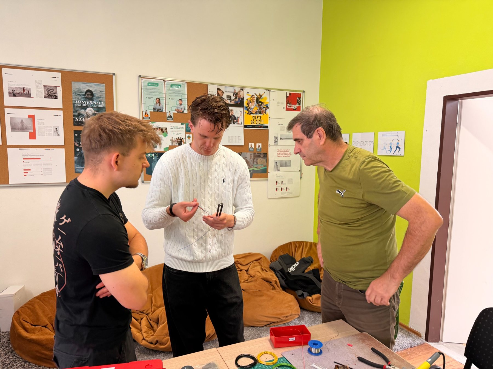 |

*The harp was built collaboratively during the Erasmus+ stay; the work shown here reflects the team effort.*

### 04 · Test, debug and present

The completed prototype combines eight laser beams, electronic signal detection, Python-based audio processing, and a touchscreen user interface. We tested the integrated system, made final adjustments, and presented the results in English.

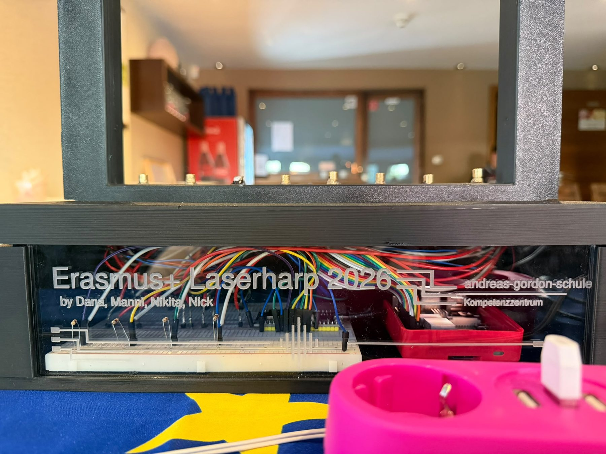

*Final enclosure detail: Raspberry Pi and the internal wiring behind the front panel.*

## Engineering challenges

| Challenge | What we did | What I learned |
|:--|:--|:--|
| **Unreliable sensor behaviour** | Compared LDRs and phototransistors and selected the more reliable approach | Validate components instead of assuming the original design will work |
| **False triggers during testing** | Improved beam alignment and stability using a 3D-printed holder | Mechanical design and signal quality affect software reliability |
| **Raspberry Pi setup failure** | Worked around a defective SD card and continued setup later | Troubleshoot the actual failure before changing unrelated components |
| **Changing USB device assignments** | Added automatic USB-port detection in the Python application | Avoid unnecessary assumptions about the runtime environment |
| **Distance sensing was not dependable** | Dropped the planned octave-distance feature to prioritize a reliable eight-beam implementation | Scope management can improve a project's final outcome |

Additional context: [Technical and development notes](docs/engineering-notes.md).

## My contribution and learning outcomes

I contributed across multiple phases of this **collaborative team project**, including planning, component and sensor testing, Raspberry Pi configuration, software integration, GUI evaluation, mechanical assembly, troubleshooting, and project documentation. I also participated in our English-language final presentation and technical exchanges with participants in Slovakia.

The project helped me develop practical skills in **hardware/software integration, Linux-based systems, Python, fault isolation, iterative prototyping and cross-cultural collaboration**. As a systems integration apprentice, the most valuable lesson was making several different components work reliably as one system.

> **Team project:** The final instrument and technical results were achieved collaboratively; I do not claim sole authorship of the design or implementation.

## Repository contents and limitations

```text
laser-harp-erasmus-2026/
├── README.md
├── assets/
│   ├── images/                # Final build, development photos, animated demo
│   └── video/                 # Final harp demonstration (MP4, with audio)
└── docs/
    ├── engineering-notes.md            # Milestones, decisions and limitations
    └── original-project-documentation.pdf  # Original bilingual team report
```

This repository is a **documented case study**, not a reproducible build or software package. The original Python scripts, ESP32 firmware, CAD source files, precise wiring diagram and dependency versions are not included. They should not be inferred from the pictures or the architecture diagram.

## Original documentation

The original team's German-English project report includes the project goals, day-by-day development log, technical issues, and the final outcome: **[Read the bilingual project documentation (PDF)](docs/original-project-documentation.pdf)**.

## Acknowledgements

This was a shared project by **Dana, Manni, Nikita and Nick** (as credited on the team's enclosure), developed during an **Erasmus+ vocational education mobility in Slovakia, September 2026**. Thanks to everyone involved in planning, fabrication, technical troubleshooting and the final presentation.

---

<sub>Documentation maintained as part of my IT systems integration learning portfolio. Media and technical work are shared here for educational project presentation; no license for reuse is granted.</sub>
